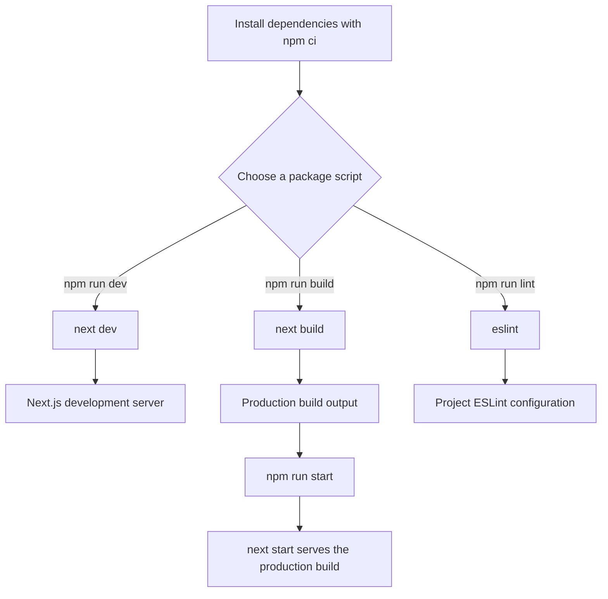
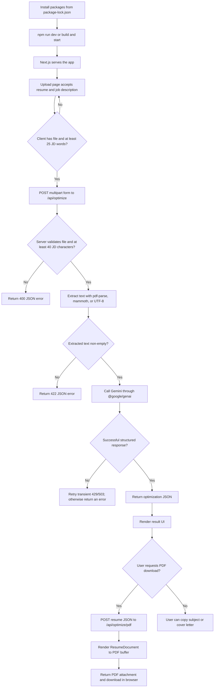

# CV Boost AI — Project and Package Guide

This README documents the root [`package.json`](./package.json): what it declares, how its scripts start the application and its tooling, and how the declared packages participate in the project. It also follows the main application paths where those packages are actually used.

## 1. Overview

`package.json` is the project’s npm manifest. It identifies the application, defines its npm commands, and declares the production and development packages needed to install, build, run, and lint it.

The project is a private Next.js application using React and TypeScript. Its visible application features include resume upload and AI optimization, PDF generation, authentication through Supabase, and a Tailwind-styled interface.

The manifest is configuration, not an executable module: it contains no functions, classes, middleware, or application data-processing logic. The scripts it declares delegate execution to the installed Next.js and ESLint command-line tools. The actual request handling and UI behavior live in files under [`app/`](./app), [`components/`](./components), and [`lib/`](./lib).

## 2. Responsibilities

The manifest has four practical responsibilities:

1. **Identify the npm project** with its name, version, and private-publication flag.
2. **Define developer and production commands** in the `scripts` object.
3. **Declare runtime dependencies** needed by application code.
4. **Declare development dependencies** used for type information, styling integration, linting, and TypeScript development.

Exact resolved dependency versions are recorded separately in [`package-lock.json`](./package-lock.json). The lockfile uses npm lockfile version 3 and mirrors the manifest’s top-level dependency declarations.

## 3. Manifest Fields and Package Installation

| Field | Value | Meaning |
|---|---|---|
| `name` | `cvboost-ai-frontend` | npm package/project identifier. |
| `version` | `0.1.0` | Current project version metadata. |
| `private` | `true` | Marks the package as private so npm will refuse to publish it. |
| `scripts` | Four commands | Shortcuts to the Next.js development, build, and production commands and ESLint. |
| `dependencies` | 13 packages | Packages required by the application at runtime/build time. |
| `devDependencies` | 9 packages | Development and build-tooling packages. |

Use the committed lockfile for a reproducible installation:

```bash
npm ci
```

`npm ci` installs the versions recorded in `package-lock.json` and fails rather than silently updating a lockfile that does not match the manifest. The repository does not declare a `packageManager` or `engines` field, so it does not specify a required npm version or Node.js version in this file.

Most dependency versions use a caret range (`^`), allowing compatible updates when resolving a fresh installation. `react` and `react-dom` are pinned to the exact version `19.2.4` in the manifest. The lockfile records the concrete versions installed for this checkout.

## 4. Scripts and How to Run Them

| Command | Manifest script | Behavior |
|---|---|---|
| `npm run dev` | `next dev` | Starts the Next.js development server, with development-time behavior and rebuilds. |
| `npm run build` | `next build` | Compiles and prepares the application for production. |
| `npm run start` | `next start` | Serves the previously built production application; run `npm run build` first. |
| `npm run lint` | `eslint` | Runs ESLint using the root [`eslint.config.mjs`](./eslint.config.mjs). No explicit path is passed, so ESLint uses its normal project-wide target behavior. |

For local development:

```bash
npm ci
npm run dev
```

The default Next.js local URL is `http://localhost:3000`. To run the production sequence:

```bash
npm run build
npm run start
```

There is no `test`, `typecheck`, or formatting script in this manifest. TypeScript is present as a development dependency, but a dedicated type-check command is not declared here.

### Script execution flow



## 5. Runtime Dependencies

These are listed under `dependencies`, rather than `devDependencies`, because application source imports or otherwise relies on them during normal application execution.

| Package | Declared version | Purpose and observed use |
|---|---:|---|
| `next` | `^16.4.0` | Application framework, routing, server endpoints, rendering, and framework helpers. App routes import `next/server`, `next/headers`, `next/navigation`, and `next/font`. The manifest scripts invoke its `dev`, `build`, and `start` CLIs. |
| `react` | `19.2.4` | UI component and state runtime used throughout the app. |
| `react-dom` | `19.2.4` | React DOM integration required by the web application and its rendering stack. |
| `@google/genai` | `^2.23.0` | Google Generative AI SDK. [`lib/gemini.ts`](./lib/gemini.ts) uses it to send resume text and a job description to the configured Gemini model and request structured JSON. |
| `@react-pdf/renderer` | `^4.9.0` | Builds the resume PDF. [`app/api/optimize/pdf/route.tsx`](./app/api/optimize/pdf/route.tsx) calls `renderToBuffer`, and [`lib/resume-pdf.tsx`](./lib/resume-pdf.tsx) defines the PDF document layout. |
| `@supabase/ssr` | `^0.12.7` | Creates Supabase clients that integrate authentication sessions with server-side request cookies. Used in [`lib/supabase/server.ts`](./lib/supabase/server.ts) and [`lib/supabase/proxy.ts`](./lib/supabase/proxy.ts). |
| `@supabase/supabase-js` | `^2.118.0` | Supabase JavaScript client and auth types/errors. [`app/auth/action.ts`](./app/auth/action.ts) uses its auth operations and `AuthError` handling. |
| `framer-motion` | `^13.4.0` | Motion and animation primitives used by the home-page components under [`components/home/`](./components/home). |
| `lucide-react` | `^1.21.0` | Icon components used across authentication, upload/results, and landing-page UI. |
| `mammoth` | `^1.13.0` | Extracts raw text from DOCX resume uploads in [`lib/extract-text.ts`](./lib/extract-text.ts). |
| `pdf-parse` | `^1.1.1` | Extracts text from PDF resume uploads. The extractor imports the package’s internal `lib/pdf-parse.js` entry point rather than its package root. |
| `react-icons` | `^5.7.0` | Supplies icon sets; the home hero imports Font Awesome icons from `react-icons/fa6`. |
| `simple-icons` | `^16.36.0` | Provides brand icons; the home hero uses the Greenhouse icon. |

## 6. Development Dependencies

These packages support authoring, linting, styling, and build-time type checking rather than representing application features.

| Package | Declared version | Purpose and observed use |
|---|---:|---|
| `typescript` | `^5` | TypeScript compiler and language tooling. [`tsconfig.json`](./tsconfig.json) enables strict checking and configures the `@/*` path alias; the manifest does not expose a type-check script. |
| `@types/node` | `^20` | Type declarations for Node.js APIs used by server-side code. |
| `@types/react` | `^19` | Type declarations for React components and APIs. |
| `@types/react-dom` | `^19` | Type declarations for React DOM APIs. |
| `@types/pdf-parse` | `^1.1.5` | Type declarations associated with `pdf-parse`. |
| `tailwindcss` | `^4` | Utility-first CSS framework. [`app/globals.css`](./app/globals.css) imports it with `@import "tailwindcss"`. |
| `@tailwindcss/postcss` | `^4` | Tailwind’s PostCSS plugin, registered in [`postcss.config.mjs`](./postcss.config.mjs). |
| `eslint` | `^10.14.0` | Linter invoked by `npm run lint`. |
| `eslint-config-next` | `^0.2.4` | Next.js ESLint presets imported by [`eslint.config.mjs`](./eslint.config.mjs), including Core Web Vitals and TypeScript rules. |

## 7. Core Components and Project Connections

Because `package.json` does not define application functions or variables, its important components are the scripts and dependency groups described above. The manifest’s runtime dependencies connect to these principal code areas:

- **Application entry and routes:** [`app/layout.tsx`](./app/layout.tsx) and route files under [`app/`](./app) use Next.js and React. The route tree includes the landing page, upload, results, dashboard, login/register, and API routes.
- **Resume optimization:** [`app/upload/page.tsx`](./app/upload/page.tsx) collects the resume file and job description, then calls `POST /api/optimize`. [`app/api/optimize/route.ts`](./app/api/optimize/route.ts) validates the request, [`lib/extract-text.ts`](./lib/extract-text.ts) extracts file text, and [`lib/gemini.ts`](./lib/gemini.ts) calls Gemini.
- **PDF output:** The result UI in [`components/upload/OptimizationResults.tsx`](./components/upload/OptimizationResults.tsx) posts the optimized resume data to `POST /api/optimize/pdf`. That route renders [`lib/resume-pdf.tsx`](./lib/resume-pdf.tsx) to a PDF response.
- **Authentication and session handling:** Server actions in [`app/auth/action.ts`](./app/auth/action.ts), the callback route in [`app/auth/callback/route.ts`](./app/auth/callback/route.ts), the dashboard, and [`app/proxy.ts`](./app/proxy.ts) use Supabase authentication clients and cookie/session integration.
- **Styling and visual assets:** Tailwind is imported in [`app/globals.css`](./app/globals.css); Framer Motion and icon packages are imported by UI components.
- **Build and lint configuration:** [`next.config.ts`](./next.config.ts), [`tsconfig.json`](./tsconfig.json), [`postcss.config.mjs`](./postcss.config.mjs), and [`eslint.config.mjs`](./eslint.config.mjs) configure tools declared by the manifest.

No database write for the resume optimization flow is visible in the inspected route and client flow: the API returns the generated result to the browser, and the result page keeps it in component state. Supabase is used for authentication/session handling in the inspected auth paths; the presence of Supabase client packages alone does not establish that resumes are stored in a database.

## 8. Complete Application Flow Through Manifest Dependencies

The manifest does not orchestrate a request by itself. It makes the framework and libraries available; the following is the observed feature flow once the app is running.

### 8.1 Resume optimization

1. The user selects a file and enters a job description on the client-side upload page.
2. The page enables submission when a file exists and the job description contains at least 25 words.
3. On submission, the browser creates `FormData` with fields named `cv` and `jobDescription`, then sends it to `POST /api/optimize`.
4. The Next.js route checks that `cv` is a `File` and that the job description is at least 40 characters after trimming. The server-side character check is a separate constraint from the UI’s word-count check.
5. `extractTextFromFile` converts the uploaded file bytes to a Node `Buffer`, then selects an extractor:
   - PDF: `pdf-parse`
   - DOCX: `mammoth`
   - TXT: UTF-8 decoding
   The file extension or MIME type is used to identify these formats.
6. If extracted text is empty, the route returns an error response. Otherwise, it passes the extracted resume text and job description to `optimizeResume`.
7. `optimizeResume` obtains a cached Google GenAI client configured with `GEMINI_API_KEY`, builds a prompt, and requests JSON matching a declared response schema from model `gemini-2.5-flash`.
8. For Gemini service responses with status `429` or `503`, the code retries up to three times after the initial attempt, waiting approximately 1, 2, and 4 seconds. It parses successful response text as JSON and returns it from the route.
9. The browser stores the result in page state and renders the match score, change summary, resume details, cover letter, and email subject.

The result JSON is expected to contain `matchScore`, `keyChanges`, `resume`, `coverLetter`, and `emailSubject`. The nested resume shape is also used by the PDF rendering code.

### 8.2 PDF download

1. The result component sends `result.resume` as JSON to `POST /api/optimize/pdf`.
2. The route checks for a resume name and experience value, renders `ResumeDocument` with `@react-pdf/renderer`, and returns a PDF attachment.
3. The browser reads the response as a Blob, creates a temporary object URL, starts a download, then revokes the URL.

### 8.3 Authentication

The Supabase SSR dependency creates server clients that read and update cookies. Server actions use the Supabase client for email/password or OAuth operations; the auth callback exchanges an OAuth code for a session. The app proxy checks the user session and redirects unauthenticated users away from `/dashboard` (and authenticated users away from configured auth pages).

### End-to-end feature flow



## 9. Data Flow and Error Handling

### Data movement

| Stage | Data | Processing and destination |
|---|---|---|
| Browser upload | `File` and job-description string | The upload page checks file presence and job-description word count, then sends multipart form data to the optimize API route. |
| API validation | `cv` and `jobDescription` form fields | The server checks field types and the minimum trimmed job-description length. |
| Text extraction | Uploaded file bytes | Converted to a `Buffer`; extracted as PDF/DOCX text or decoded as UTF-8 for TXT. |
| AI request | Extracted CV text and job description | Embedded in the Gemini prompt and sent through `@google/genai`; generated response is requested as schema-constrained JSON. |
| Browser result | Optimization result JSON | Stored in React state and displayed. The resume part is later sent to the PDF endpoint when download is requested. |
| PDF response | Structured resume data | Rendered into a PDF buffer and returned with PDF content headers. |

The optimization route is explicitly configured for the Node.js runtime because its file-parsing and Gemini dependencies require Node APIs. Its maximum duration is set to 60 seconds. Resume text and job-description contents are sent to the configured Gemini service; the inspected optimization route does not write them to a database.

### Errors surfaced by the observed flow

- **Missing file or short/missing job description:** `POST /api/optimize` returns HTTP 400 with a JSON error.
- **No readable extracted text:** The route returns HTTP 422 with an explanation.
- **Unsupported upload type or extraction failure:** The extractor throws; the API route logs the failure and returns HTTP 500 JSON. The upload page displays the returned error when available.
- **Missing Gemini API key:** Client creation throws an explicit configuration error, which is returned through the optimize route’s error response.
- **Gemini transient errors:** Status `429` and `503` are retried up to three times after the first request. If still transient after the final attempt, a user-facing overload message is thrown. Other errors fail without retry.
- **Empty or malformed Gemini response:** An empty response or JSON parse failure becomes an error and does not qualify for the transient retry policy.
- **PDF generation failure:** The PDF route logs the exception and responds with HTTP 500. The UI shows a download error.
- **Clipboard failure:** The result component catches browser clipboard errors and shows a permission-related message.
- **Authentication errors:** Supabase auth errors are translated into user-facing messages by the auth actions; the proxy and callback also redirect when a session is missing or OAuth exchange fails.

## 10. Environment Configuration

The manifest does not define environment variables, but inspected source files read the following values:

| Variable | Use observed in code |
|---|---|
| `GEMINI_API_KEY` | Configures the Google GenAI client in [`lib/gemini.ts`](./lib/gemini.ts). |
| `NEXT_PUBLIC_SUPABASE_URL` | Supabase project URL used by SSR clients. |
| `NEXT_PUBLIC_SUPABASE_PUBLISHABLE_KEY` | Supabase publishable key used by SSR clients. |
| `NEXT_PUBLIC_SITE_URL` | Used for the site’s metadata URL and as a fallback origin in auth actions. |

Set these in the environment used to run or deploy the application. The repository’s manifest does not provide their values or configure a secrets manager.

## 11. Execution Examples

### Start a local development server

```bash
npm ci
npm run dev
```

Open `http://localhost:3000`, navigate to the upload page, choose a PDF, DOCX, or TXT resume, and enter a job description long enough to satisfy both the UI and server checks. A successful response displays the generated result.

### Build and serve production

```bash
npm run build
npm run start
```

`start` serves the production build; it is not the build command itself.

### Run the configured lint command

```bash
npm run lint
```

This invokes ESLint with the project configuration. It does not run tests or a dedicated TypeScript type-check script.

## 12. Important Technical Decisions and Boundaries

- **Separate runtime and development dependencies:** Application libraries are declared in `dependencies`; tooling and type packages are in `devDependencies`.
- **Lockfile-backed npm installation:** The committed npm lockfile records resolved package versions. `npm ci` is the appropriate reproducible install for clean environments and CI.
- **Framework scripts instead of custom launch code:** The scripts directly invoke Next.js commands. Development, production build, and serving are distinct phases.
- **Server-side processing of uploaded files:** PDF/DOCX extraction and Gemini invocation run in a Node.js API route rather than the Edge runtime because these dependencies need Node APIs.
- **Structured AI output:** The Gemini request includes a JSON response schema, which gives the UI and PDF generator a defined expected shape. The code still parses the returned text and reports malformed output.
- **No persistence guarantee from this manifest:** Dependency declarations show available packages, not that every feature uses them. In particular, the observed optimize/result flow holds the result in browser state and passes it to the PDF route; this alone does not document storage or retention behavior elsewhere.
- **No test or type-check command is declared:** Additions to scripts would be required before `npm test` or an npm type-check script can be assumed to exist.
